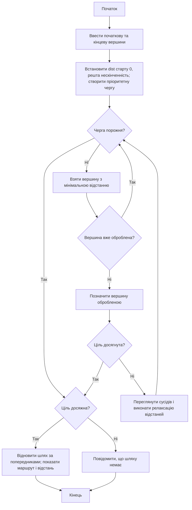

# Лабораторна робота №5 — Алгоритм Дейкстри

## Запуск (Windows)

1. Встановити Python 3.10 або новішу версію з підтримкою Tkinter.
2. У папці проєкту відкрити термінал.
3. Виконати `python -m pip install -r requirements.txt`.
4. Виконати `python main.py`.

## Виконання роботи

- У початковому графі 50 двосторонніх доріг з таблиці 1 методички.
- Вибрати початкове й кінцеве міста та натиснути «Знайти найкоротший шлях».
- Натискати «Наступний крок» або «Автоматична візуалізація» для спостереження за алгоритмом.
- Натиснути «Показати результат» для окремого вікна з маршрутом та відстанню.
- Для експериментів видалити ребро з отриманого шляху, повторити пошук і порівняти відстані.
- Додати або видалити вершину, повторити пошук; для нової вершини необхідно додати дороги.
- «Відновити початковий граф» повертає вихідні дані.

Примітка: розташування міст приблизно відповідає географічним координатам, але ребра є прямими відрізками між вершинами, а не реальною геометрією доріг. Ваги взято виключно з таблиці методички, а не з географічної відстані.

## Теоретичне пояснення

Звичайний пошук у ширину (BFS) мінімізує кількість ребер і працює з чергою FIFO. Алгоритм Дейкстри узагальнює пошук для невід'ємних ваг: кожного разу остаточно обирає невідвідану вершину з найменшою поточною відстанню від старту. Для сусідів виконує релаксацію: якщо `dist[u] + weight(u,v) < dist[v]`, відстань і попередник оновлюються. У реалізації використовується пріоритетна черга (мін-купа). Складність — O((V+E) log V).

## Блок-схема алгоритму (Mermaid)

## Дослідження

Провести не менше трьох запусків: (1) початковий граф, (2) граф без ребра знайденого шляху, (3) граф після зміни набору вершин. Записати маршрути, довжини та пояснити різницю. Точна пара міст має відповідати варіанту викладача.
